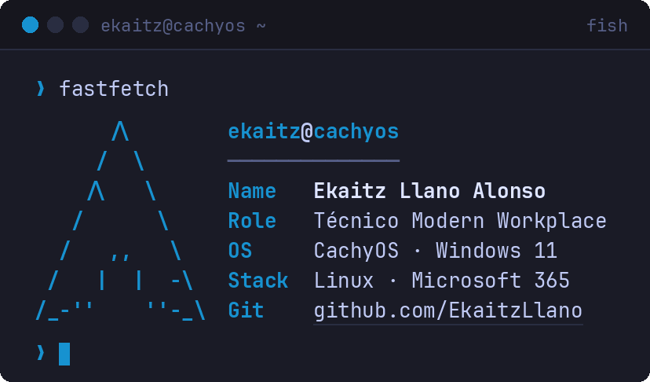

# firma

Firma de correo animada estilo `fastfetch` (Gmail).



Generada con `gen_gif_fastfetch.py` (Pillow + JetBrains Mono Nerd Font):

```sh
python3 gen_gif_fastfetch.py firma.gif
```

El primer fotograma es la firma completa, para los clientes de correo que no animan GIF.
